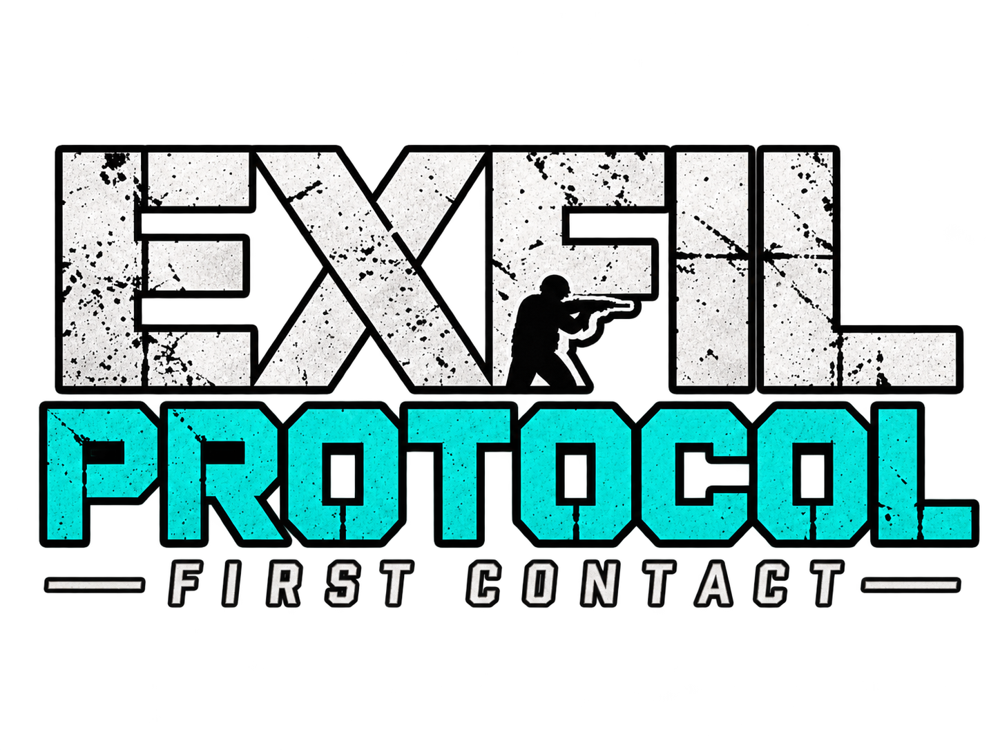
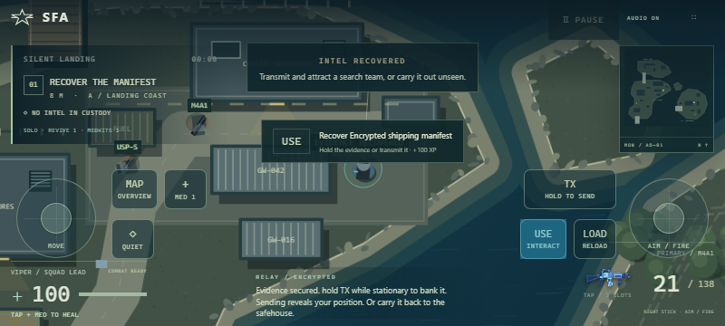

# EXFIL PROTOCOL: FIRST CONTACT

<p align="center"></p>

**A tactical extraction browser game by Aniket [UGZ].** Two playable missions, a risky evidence uplink, optional squad support, enemy weapon pickups and boat travel across Mon Breakwater Island.

**[Play in your browser](https://aniketspecter.github.io/exfil-protocol-first-contact/)** · [Design notes](docs/GAME_DESIGN.md) · [Architecture](docs/ARCHITECTURE.md) · [Testing](docs/TESTING.md)

No installation or account is needed. Use a desktop browser or turn your phone to landscape. The first tap enables audio. This is a playable prototype, not a finished commercial release.

## The story

Four went in. The record says none returned.

Before the silence, Viper One landed on Mon Breakwater Island to investigate unidentified shipping and a private military force. You are Viper, the squad leader. Recover the evidence, decide what to transmit and find a way home. Each successful extraction uncovers another part of the operation that preceded the squad's disappearance.

- **01 / Silent Landing:** infiltrate the coastal warehouses, recover an encrypted shipping manifest and return to the southern safehouse dock. Medical supplies and ammunition are optional detours.
- **02 / Dead Frequency:** unlocked by completing the first contract. Take the boat to Lighthouse Ridge, recover compromised radio logs, optionally disable surveillance, then sail back and extract. The logs suggest someone knew Viper One's orders before the squad arrived.

Later campaign entries are marked as future concepts. Only these two contracts are playable.

## How to play

1. Start an operation, choose Solo or Squad, and read the mission briefing.
2. Move between cover and recover the marked evidence with **Interact / USE**.
3. Carry it quietly to extraction, or hold **Transmit / TX** while stationary. A completed uplink banks evidence even if you die, but patrols investigate your signal.
4. Return to the dock and survive the extraction countdown. In Mission 02, use the boat menu to sail back and choose **Return to Safehouse**.

In Solo, you have one self-revive. When downed, hold Revive while safe from direct fire. Squad mode adds Doc and Spectre, who follow, fight and attempt a safe revival. One player recovery is available per raid; the next lethal injury ends the attempt. Cover blocks sight and gunfire. Reload before pushing into a patrol's line of fire.

## Controls

| Action                             | PC                  | Phone / tablet landscape      |
| ---------------------------------- | ------------------- | ----------------------------- |
| Move                               | WASD                | Left stick                    |
| Aim / fire                         | Mouse / left button | Push right stick outward      |
| Interact, collect intel, use boat  | E                   | USE                           |
| Select primary / secondary / knife | 1 / 2 / 3           | Tap weapon panel, choose slot |
| Previous weapon                    | Q                   | Select another slot           |
| Reload                             | R                   | LOAD / RELOAD                 |
| Quiet movement                     | Hold Shift          | QUIET toggle                  |
| Bank evidence                      | Hold T, stay still  | Hold TX, stay still           |
| Heal with a carried medkit         | H or health panel   | + MED or health panel         |
| Solo self-revive                   | Hold E when downed  | Hold REVIVE                   |
| Map / pause                        | M / Escape          | MAP / Pause                   |
| Fullscreen / audio                 | Top bar             | Top bar, where supported      |

**Customize your touch layout:** Settings or Pause → Customize Touch Controls. Drag any of ten controls, adjust individual size and opacity, then Save. Hide Options to reach the area behind the toolbar. Cancel preserves the previous layout; Defaults restores the standard layout when saved. Gameplay stays paused while editing. Preferences save in your browser and adapt to the viewport; avoid placing buttons on top of one another.

Your loadout has three slots: primary, secondary and knife. Bots drop the gun they carry. Use near it or tap/click the ground weapon. A different gun replaces that slot and leaves your old weapon on the ground; a matching gun adds its remaining ammunition. The knife has a short melee attack and gives **22% faster normal movement**. Boat journeys preserve health, ammunition, equipment, intel and surviving companions.

<p align="center"></p>

## Features in this build

- Two distinct contracts and mission-unlock progression.
- Evidence carry-versus-transmit decisions, investigation and response patrols.
- Authored patrol, suspicion, combat, search and cover behavior.
- Solo recovery or optional two-companion squad support.
- Three weapon slots, enemy drops, ammunition and medkits.
- Directional boat travel with passengers, wake animation and pause/resume.
- Desktop input and simultaneous two-thumb touch controls.
- Responsive menus and persistent phone action bars.
- Local saves, XP, evidence archive and a signal-scrambler unlock.

The public edition now includes the selected tactical operators, weapon sprites, terrain and props used in the local build, plus EXFIL/Counter-Strike ocean, boat, weapon, footstep, bot and operator audio. The supplied EXFIL title theme plays on menu screens after the first interaction and fades out on deployment. See [Attribution](ATTRIBUTION.md) for creator and tool credits.

## Run locally

Requires Node.js 20.11 or newer and npm. Node 22 is used in CI.

```sh
git clone https://github.com/AniketSpecter/exfil-protocol-first-contact.git
cd exfil-protocol-first-contact
npm ci
npm run dev
```

Open the local URL printed by Vite. For a production build:

```sh
npm test
npm run build
npm run preview
```

Use an HTTP server; opening index.html directly from the file system will not load the module build. If browser graphics fail, append `?renderer=canvas` to the game URL. Fullscreen requires a user tap/click and browser support.

## Media profiles

`npm run build` creates the full-media edition used by GitHub Pages. It contains 35 selected graphics, 31 sound cues (26 gameplay/voice cues and five UI sounds) in a compiled audio bank and the supplied menu theme. `public/assets/game/catalog.json` contains only relative runtime paths, cue boundaries and file hashes. It contains no source-machine paths.

`npm run build:portable` is an optional edition with code-rendered replacement sprites/terrain and synthesized effects. It excludes the selected game media and menu score. Preview that edition with `node scripts/vite.mjs preview --portable`.

Audio On/Off controls effects, voices and ambience. Music On/Off independently controls the menu soundtrack. Both preferences save in the browser. Browser autoplay rules require a first tap, click or keypress. Menu music fades when deploying, returns in menus, and pauses when the tab is hidden. Physical device audio behavior still needs testing.

## Code overview

The project uses **Phaser 3.90**, ES modules and Vite. `src/scenes/Raid.js` coordinates the raid. Small modules handle authored geometry, pathfinding, enemy and companion behavior, saves, audio, display changes and touch layouts. `src/ui.js` presents mission flow and the HUD; `src/ui-journey.js` draws the scripted boat crossing. Data definitions keep mission and weapon tuning separate from rendering. See [Architecture](docs/ARCHITECTURE.md).

## Testing and limitations

Unit checks cover saves, reward idempotency, geometry, reachability and touch-layout validation. Browser checks include two complete keyboard/mouse routes and two complete touch-emulated routes with live guards. Focused fixtures isolate failure/recovery, weapons, boat state and layout editing; they are identified in each report. Responsive checks cover phone portrait/landscape, tablet and desktop layouts. See [Testing](docs/TESTING.md) for commands and scope.

Physical Android/iOS testing, human balance studies and accessibility review remain pending. Automated route timing is not evidence of human session length or retention. Squad navigation is intentionally forgiving and can reform a distant follower. No multiplayer, manual boat steering, operator switching, cloud saves, purchases or analytics are implemented.

## Privacy and deployment

Mission progress, audio/music preferences and touch layout stay in local browser storage. GitHub Pages serves static files; the game has no account system, application server or third-party analytics. A different browser or origin has a separate save.

The Pages workflow installs locked dependencies, runs checks, builds the full-media edition and deploys only `dist`. Only selected runtime graphics, the compiled sound bank and menu score are included. Full source-game installations, original sound-pack folders, private import manifests, workstation paths, private assessment documents and test captures remain excluded. [Deployment instructions](docs/DEPLOYMENT.md).

## Credits

Creative direction, EXFIL concept and story: **Aniket [UGZ]**. Inspired by the tactical atmosphere of Counter-Strike 1.6 and the geography of de_mon by MaMuS. Character and weapon designs were developed with Auto Sprite AI. AI-assisted programming supported gameplay implementation, interface development and automated testing, under the creative direction of Aniket [UGZ]. The default browser edition uses the restored game media; an optional replacement profile renders fallback sprites in code and synthesizes its effects.

This is an independent project, not an official Counter-Strike or Valve release. Dependencies and third-party items keep their respective licenses. Project code and creator-supplied artwork are published for play and review; no general reuse license is granted. See [Rights](RIGHTS.md).
